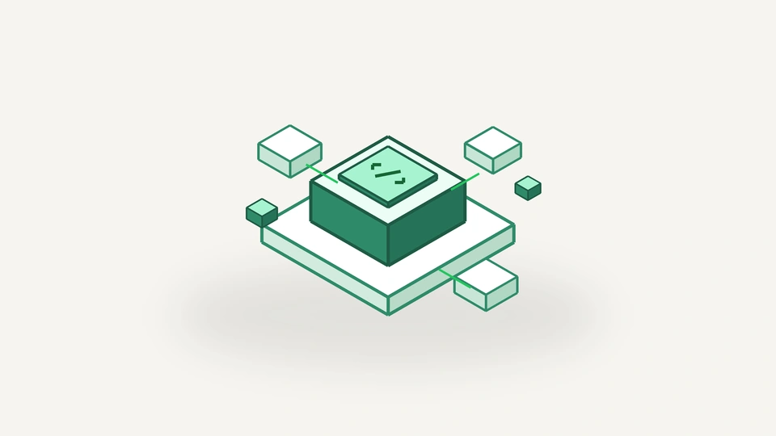
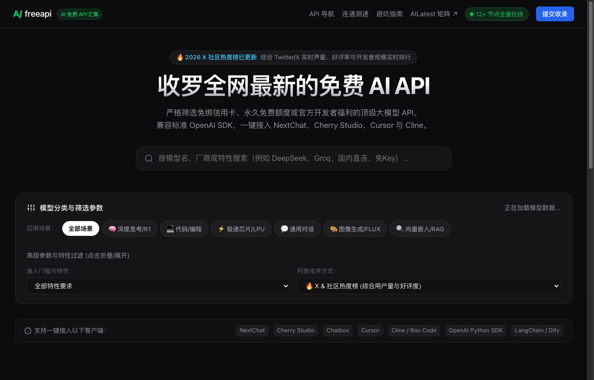

<a id="top"></a>
<p align="right">
  <b>English</b> | <a href="#chinese"><b>中文说明</b></a>
</p>

# FreeAPI Hub · Curated Free AI API Gateway & Playground ⚡️

<p align="center">
  <b>Strictly curated zero-credit-card, permanently free, or official developer-tier LLM APIs.</b><br>
  100% compatible with standard OpenAI SDKs. One-click integration for NextChat, Cherry Studio, Cursor, Cline, Python, and Node.js.
</p>

<p align="center">
  <a href="https://freeapi.ailatest.org/"></a>
  <a href="https://freeapi.ailatest.org/#catalog"></a>
  <a href="https://freeapi.ailatest.org/#playground"></a>
  
</p>

---

## 🖼 Visual Showcase

### 1. Official Cover Art
<p align="center">
  
</p>

### 2. Live Application Interface
<p align="center">
  <a href="https://freeapi.ailatest.org/">
    
  </a>
</p>
<p align="center"><em>Live screenshot captured from production: <a href="https://freeapi.ailatest.org/">freeapi.ailatest.org</a>.</em></p>

---

## 🌟 Key Features

1. **Zero-Credit-Card Verification**: All featured channels are strictly tested to ensure zero mandatory credit card binding and zero hidden charges.
2. **Community Popularity Ranking**: Dynamically aggregated from Twitter/X developer chatter, GitHub trending, and Reddit discussions to reflect real-world throughput and stability.
3. **Universal OpenAI SDK Compatibility**: Seamless drop-in replacement for OpenAI endpoints (`v1/chat/completions`). Compatible with Python, Node.js, cURL, NextChat, Cherry Studio, Chatbox, Cursor, Cline, and Roo Code.
4. **Interactive Latency & Speed Playground**: Directly test Time-To-First-Token (TTFT), tokens-per-second throughput, and connection latency in your browser before deployment.
5. **Step-by-Step API Key Guides**: Direct deep-links and illustrated 3-step guides showing how to generate developer credentials in under 2 minutes.

---

## 🏆 2026 Developer Popularity Leaderboard (X & Reddit Weighted)

| Rank | Provider | Highlights | Recommended Model | Free Tier Specs | Context Window |
| :---: | :--- | :--- | :--- | :--- | :---: |
| 🥇 **TOP 1** | **Groq Cloud** | Custom LPU hardware, extreme 500+ tok/s speed | `deepseek-r1-distill-llama-70b` | 30 RPM / Permanent Free | 128K |
| 🥈 **TOP 2** | **Google AI Studio** | Generous developer limits & massive multimodal context | `gemini-2.5-flash` | 15 RPM / 1,500 RPD | 1M ~ 2M |
| 🥉 **TOP 3** | **OpenRouter Free** | Multi-model aggregation gateway | `deepseek/deepseek-r1:free` | 20 RPM / 200 RPD | 128K |
| 🏅 **TOP 4** | **OpenCode Go** | DeepSeek V4.1 high-speed direct access | `deepseek-v4.1-chat` | Official free channel | 200K |
| 🏅 **TOP 5** | **GitHub Models** | Azure AI powered developer benefit for GitHub users | `DeepSeek-R1` / `gpt-4o` | 15 RPM / 150 RPD | 128K |
| **TOP 6** | **Cerebras Cloud** | Wafer-Scale Engine, sub-second latency | `llama3.3-70b` | 30 RPM / High Throughput | 128K |
| **TOP 7** | **SiliconFlow** | Fast direct connection in East Asia | `deepseek-ai/DeepSeek-V3` | Generous signup balance | 128K |
| **TOP 8** | **Pollinations AI** | Pure zero-barrier anonymous endpoint | `openai-large` / `flux` | Public API / No Key | 32K |
| **TOP 9** | **SambaNova Systems** | Dedicated SN40L accelerators for R1 | `DeepSeek-R1` | Free Developer Tier | 64K |
| **TOP 10** | **Cloudflare Workers AI** | Edge computing inference across 300+ datacenters | `@cf/meta/llama-3.3-70b` | 10,000 Neurons/Day | 128K |
| **TOP 11** | **Mistral AI** | European flagship open weights with FIM support | `codestral-latest` | Free Developer Tier | 128K |
| **TOP 12** | **Cohere** | Industry-standard RAG embeddings & reranking | `command-r-plus` | 1,000 Free Calls/Month | 128K |

---

## 💻 Quickstart Code Examples (Groq Example)

### cURL
```bash
curl https://api.groq.com/openai/v1/chat/completions \
  -H "Authorization: Bearer gsk_YOUR_KEY" \
  -H "Content-Type: application/json" \
  -d '{
    "model": "deepseek-r1-distill-llama-70b",
    "messages": [{"role": "user", "content": "Explain quicksort in 2 sentences."}]
  }'
```

### Python (OpenAI SDK)
```python
from openai import OpenAI

client = OpenAI(
    base_url="https://api.groq.com/openai/v1",
    api_key="gsk_YOUR_KEY"
)

response = client.chat.completions.create(
    model="deepseek-r1-distill-llama-70b",
    messages=[{"role": "user", "content": "Explain quicksort in 2 sentences."}]
)
print(response.choices[0].message.content)
```

---

<a id="chinese"></a>
<p align="right">
  <a href="#top"><b>Back to Top (English)</b></a> | <b>中文说明</b>
</p>

## 🇨🇳 中文介绍 · FreeAPI Hub

### 为什么需要 FreeAPI？
在 AI 应用开发过程中，很多开发者都曾遇到过：
- 官方平台强制要求绑定海外信用卡（Visa/MasterCard），国内开发者门槛极高；
- 试用期结束后被隐性自动续费或高额扣费；
- 各家大模型的 API 规范不一，调试成本高昂。

**FreeAPI 针对以上痛点打造**：严格筛选免绑信用卡、永久免费额度或官方开发者福利的顶级大模型通道。100% 兼容标准 OpenAI 协议，一键接入 NextChat、Cherry Studio、Cursor、Cline、Python 与 Node.js。

### 核心亮点
1. **真实免信用卡门槛**：杜绝强制扣费陷阱，所有通道均经过实测可免绑卡申请。
2. **X / Reddit 开发者社区热度榜**：根据调用成功率、出词速度（Tokens/s）与社区好评实时更新排名。
3. **网页端连通与测速台 (Playground)**：无需本地配置，在线输入 Prompt 即时测试端到端首字响应时间（TTFT）与吞吐量。
4. **一键接入代码生成器**：一键生成适用于各大开源客户端及主流编程语言的初始化配置代码。

🌐 **立即在线体验**：[**https://freeapi.ailatest.org/**](https://freeapi.ailatest.org/)
